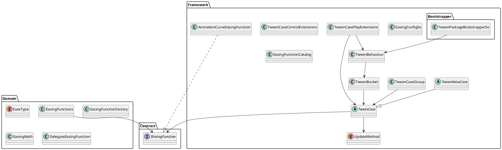

> 2.1.0: [TweenPlayer 비동기 재생과 UITK opacity/scale 계약](Documentation~/async-and-uitk.md)을 추가했습니다. 실제 태그 게시·릴리즈·게임 이전은 별도 단계입니다.

# SWeetJelly Tween

## 2.0 안내

Unity 6.3 LTS, Bootstrapper 2.0.0과 uGUI 2.0.0을 기준으로 한다. TMP 기능과 Unity.TextMeshPro 참조는 유지하며, 미사용 Utils와 별도 TMP 패키지 선언을 제거했다. runtime에서 사용하는 Audio/Animation 모듈은 직접 선언한다.

현재 실행 진입점은 ITweenService/TweenService이며 TweenBehaviour는 Unity frame 시간을 전달하는 adapter다. 아래의 과거 runner 설명보다 [현재 사용법](README.md), [아키텍처](ARCHITECTURE.md), [이전 안내](Documentation~/migration-2.0.md)를 우선한다. 기존 public/protected API·serialized player 필드·GUID와 custom TweenPlayerBehaviour 상속을 보존한다.

handle은 한 실행의 완료 또는 Kill을 관찰하며 ToTask는 정상 완료 시 성공, Kill/취소 시 canceled로 끝난다. 호출·설정·취소를 순차 수행하고 Unity 대상과 token 취소는 main thread에서 다룬다. callback 실패·종료 observer·등록 및 driver 소유권의 정확한 규칙은 아키텍처와 이전 안내에 있다.

사용자가 작성한 [TweenPlayer 가이드](Documentation~/TweenPlayerDesignerGuide.ko.md)와 [Animator 가이드](Documentation~/AnimatorTweenPlayerDesignerGuide.ko.md)를 유지한다. 2.1.0의 TweenPlayer 비동기 재생은 [별도 계약](Documentation~/async-and-uitk.md)을 따르며, Inspector binding과 게임 이전 등 남은 범위는 [후속 TODO](Documentation~/TODO.md)에 기록했다.

SWeetJelly Tween은 Unity object, UI, text, renderer, material, transform 등을 시간에 따라 보간하기 위한 tween module입니다.

easing function은 domain layer에 두고, 실제 Unity object를 변경하는 concrete tween case는 framework layer에 둡니다. `TweenBehaviour`는 Unity update loop에서 tween을 실행하는 runner 역할을 합니다.

## 구조



## Easing

`EaseType`과 easing function은 tween progress를 실제 value curve로 변환합니다.

기본 easing은 domain layer에서 제공하며, Unity `AnimationCurve` 기반 easing은 framework layer에서 사용할 수 있습니다.

```csharp
rectTransform
    .DOAnchoredPosition(new Vector2(100f, 0f), 0.3f)
    .SetEasing(EaseType.SineOut)
    .Play(tweenBehaviour);
```

## Concrete TweenCase

Framework layer에는 Unity object에 side effect를 적용하는 concrete tween case들이 있습니다.

지원 영역:

- Animation
- Audio
- Camera
- Graphic
- Image
- Material
- Particle
- RectTransform
- Renderer
- SpriteRenderer
- Text
- Transform
- UI

## RectTransform 예시

```csharp
rectTransform
    .DOAnchoredPosition(new Vector2(100f, 0f), 0.3f)
    .SetEasing(EaseType.SineOut)
    .Play(tweenBehaviour);
```

```csharp
graphic
    .DOAnchoredPositionShake(10f, 0.25f)
    .Play(tweenBehaviour);
```

```csharp
rectTransform
    .DOSize(new Vector2(300f, 100f), 0.2f)
    .Play(tweenBehaviour);
```

## Renderer 예시

```csharp
private static readonly int ColorId = Shader.PropertyToID("_BaseColor");
private static readonly int CutoffId = Shader.PropertyToID("_Cutoff");

renderer
    .DOPropertyBlockColor(ColorId, Color.red, 0.3f)
    .Play(tweenBehaviour);

renderer
    .DOPropertyBlockFloat(CutoffId, 1f, 0.3f)
    .Play(tweenBehaviour);
```

## SpriteRenderer

`SpriteRenderer`의 color tween과 fade tween은 같은 `color` 값을 수정합니다.

같은 target에 color tween과 fade tween을 동시에 걸면 서로 값을 덮어쓸 수 있으므로, 동일 target에는 같은 시점에 하나의 color 계열 tween만 실행하는 것이 안전합니다.

## TweenCases

일반적인 tween case helper:

```plantuml
TweenCases
AsyncOperationTweenExtensions

DelayTweenCase
FloatTweenCase
ColorTweenCase
ActionTweenCase<T>
ConditionTweenCase
WaitUntilTweenCase
NextFrameTweenCase
AsyncOperationTweenCase
```

```csharp
TweenCases
    .DelayedCall(0.5f, () => Debug.Log("Done"))
    .Play(tweenBehaviour);
```

```csharp
TweenCases
    .DOFloat(0f, 1f, 0.25f, value => canvasGroup.alpha = value)
    .SetEasing(EaseType.SineOut)
    .Play(tweenBehaviour);
```

```csharp
TweenCases
    .NextFrame(() => Debug.Log("Next frame"))
    .Play(tweenBehaviour);
```

```csharp
operation
    .OnCompleted(() => Debug.Log("Load completed"))
    .Play(tweenBehaviour);
```

## Text

text tween extension은 legacy text, TextMesh, TMP text를 대상으로 합니다.

```plantuml
TextTweenExtensions

UnityTextFontSizeTweenCase
TextMeshFontSizeTweenCase
TextMeshFadeTweenCase
TextMeshColorTweenCase
TMPTextFontSizeTweenCase
```

```csharp
legacyText
    .DOFontSize(32, 0.25f)
    .SetEasing(EaseType.SineOut)
    .Play(tweenBehaviour);
```

```csharp
textMesh
    .DOFade(0f, 0.2f)
    .Play(tweenBehaviour);
```

```csharp
tmpText
    .DOFontSize(42f, 0.3f)
    .Play(tweenBehaviour);
```

## Transform

transform tween은 position, rotation, scale, path, follow, shake 등을 지원합니다.

```plantuml
TransformTweenExtensions

TransformPositionTweenCase
TransformPositionAxisTweenCase
TransformLocalPositionTweenCase
TransformLocalPositionAxisTweenCase
TransformScaleTweenCase
TransformScaleAxisTweenCase
TransformRotationEulerTweenCase
TransformRotationQuaternionTweenCase
TransformLocalRotationEulerTweenCase
TransformLocalRotationQuaternionTweenCase
TransformConstantRotationTweenCase
TransformPathTweenCase
TransformBezierPositionTweenCase
TransformFollowTweenCase
TransformBezierFollowTweenCase
TransformPushScaleTweenCase
TransformPingPongScaleTweenCase
TransformLookAtTweenCase
TransformLookAt2DTweenCase
TransformShakeTweenCase
```

```csharp
transform
    .DOMove(new Vector3(0f, 2f, 0f), 0.3f)
    .SetEasing(EaseType.SineOut)
    .Play(tweenBehaviour);
```

```csharp
transform
    .DOScale(1.2f, 0.2f)
    .Play(tweenBehaviour);
```

```csharp
transform
    .DORotate(new Vector3(0f, 180f, 0f), 0.5f)
    .SetEasing(EaseType.SineInOut)
    .Play(tweenBehaviour);
```

```csharp
transform
    .DOShake(0.2f, 0.3f)
    .Play(tweenBehaviour);
```

## UI

UI tween extension은 layout과 canvas group 계열 tween을 포함합니다.

```plantuml
UITweenExtensions
LayoutElementPreferredHeightTweenCase
CanvasGroupFadeTweenCase
```

## TweenPlayerBehaviour

`TweenPlayerBehaviour`는 inspector에서 설정한 tween을 실행하기 위한 component입니다.

- inspector-driven tween player
- 매 loop마다 `TweenCase` 생성
- `TweenBehaviour.Play` 기반 실행
- `EaseType` 사용
- concrete player는 `CreateTweenCase`만 구현
