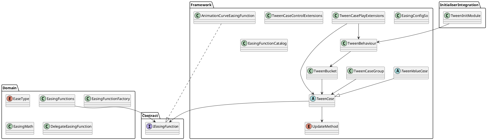

# SWeetJelly Tween

SWeetJelly Tween은 Unity object, UI, text, renderer, material, transform 등을 시간에 따라 보간하기 위한 tween module입니다.

easing function은 domain layer에 두고, 실제 Unity object를 변경하는 concrete tween case는 framework layer에 둡니다. `TweenBehaviour`는 Unity update loop에서 tween을 실행하는 runner 역할을 합니다.

## 구조



## Easing

`EaseType`과 easing function은 tween progress를 실제 value curve로 변환합니다.

기본 easing은 domain layer에서 제공하며, Unity `AnimationCurve` 기반 easing은 framework layer에서 사용할 수 있습니다.

```csharp
rectTransform
    .DOAnchoredPosition(new Vector2(100f, 0f), 0.3f)
    .SetEasing(EaseType.SineOut)
    .Play(tweenBehaviour);
```

## Concrete TweenCase

Framework layer에는 Unity object에 side effect를 적용하는 concrete tween case들이 있습니다.

지원 영역:

- Animation
- Audio
- Camera
- Graphic
- Image
- Material
- Particle
- RectTransform
- Renderer
- SpriteRenderer
- Text
- Transform
- UI

## RectTransform 예시

```csharp
rectTransform
    .DOAnchoredPosition(new Vector2(100f, 0f), 0.3f)
    .SetEasing(EaseType.SineOut)
    .Play(tweenBehaviour);
```

```csharp
graphic
    .DOAnchoredPositionShake(10f, 0.25f)
    .Play(tweenBehaviour);
```

```csharp
rectTransform
    .DOSize(new Vector2(300f, 100f), 0.2f)
    .Play(tweenBehaviour);
```

## Renderer 예시

```csharp
private static readonly int ColorId = Shader.PropertyToID("_BaseColor");
private static readonly int CutoffId = Shader.PropertyToID("_Cutoff");

renderer
    .DOPropertyBlockColor(ColorId, Color.red, 0.3f)
    .Play(tweenBehaviour);

renderer
    .DOPropertyBlockFloat(CutoffId, 1f, 0.3f)
    .Play(tweenBehaviour);
```

## SpriteRenderer

`SpriteRenderer`의 color tween과 fade tween은 같은 `color` 값을 수정합니다.

같은 target에 color tween과 fade tween을 동시에 걸면 서로 값을 덮어쓸 수 있으므로, 동일 target에는 같은 시점에 하나의 color 계열 tween만 실행하는 것이 안전합니다.

## TweenCases

일반적인 tween case helper:

```plantuml
TweenCases
AsyncOperationTweenExtensions

DelayTweenCase
FloatTweenCase
ColorTweenCase
ActionTweenCase<T>
ConditionTweenCase
WaitUntilTweenCase
NextFrameTweenCase
AsyncOperationTweenCase
```

```csharp
TweenCases
    .DelayedCall(0.5f, () => Debug.Log("Done"))
    .Play(tweenBehaviour);
```

```csharp
TweenCases
    .DOFloat(0f, 1f, 0.25f, value => canvasGroup.alpha = value)
    .SetEasing(EaseType.SineOut)
    .Play(tweenBehaviour);
```

```csharp
TweenCases
    .NextFrame(() => Debug.Log("Next frame"))
    .Play(tweenBehaviour);
```

```csharp
operation
    .OnCompleted(() => Debug.Log("Load completed"))
    .Play(tweenBehaviour);
```

## Text

text tween extension은 legacy text, TextMesh, TMP text를 대상으로 합니다.

```plantuml
TextTweenExtensions

UnityTextFontSizeTweenCase
TextMeshFontSizeTweenCase
TextMeshFadeTweenCase
TextMeshColorTweenCase
TMPTextFontSizeTweenCase
```

```csharp
legacyText
    .DOFontSize(32, 0.25f)
    .SetEasing(EaseType.SineOut)
    .Play(tweenBehaviour);
```

```csharp
textMesh
    .DOFade(0f, 0.2f)
    .Play(tweenBehaviour);
```

```csharp
tmpText
    .DOFontSize(42f, 0.3f)
    .Play(tweenBehaviour);
```

## Transform

transform tween은 position, rotation, scale, path, follow, shake 등을 지원합니다.

```plantuml
TransformTweenExtensions

TransformPositionTweenCase
TransformPositionAxisTweenCase
TransformLocalPositionTweenCase
TransformLocalPositionAxisTweenCase
TransformScaleTweenCase
TransformScaleAxisTweenCase
TransformRotationEulerTweenCase
TransformRotationQuaternionTweenCase
TransformLocalRotationEulerTweenCase
TransformLocalRotationQuaternionTweenCase
TransformConstantRotationTweenCase
TransformPathTweenCase
TransformBezierPositionTweenCase
TransformFollowTweenCase
TransformBezierFollowTweenCase
TransformPushScaleTweenCase
TransformPingPongScaleTweenCase
TransformLookAtTweenCase
TransformLookAt2DTweenCase
TransformShakeTweenCase
```

```csharp
transform
    .DOMove(new Vector3(0f, 2f, 0f), 0.3f)
    .SetEasing(EaseType.SineOut)
    .Play(tweenBehaviour);
```

```csharp
transform
    .DOScale(1.2f, 0.2f)
    .Play(tweenBehaviour);
```

```csharp
transform
    .DORotate(new Vector3(0f, 180f, 0f), 0.5f)
    .SetEasing(EaseType.SineInOut)
    .Play(tweenBehaviour);
```

```csharp
transform
    .DOShake(0.2f, 0.3f)
    .Play(tweenBehaviour);
```

## UI

UI tween extension은 layout과 canvas group 계열 tween을 포함합니다.

```plantuml
UITweenExtensions
LayoutElementPreferredHeightTweenCase
CanvasGroupFadeTweenCase
```

## TweenPlayerBehaviour

`TweenPlayerBehaviour`는 inspector에서 설정한 tween을 실행하기 위한 component입니다.

- inspector-driven tween player
- 매 loop마다 `TweenCase` 생성
- `TweenBehaviour.Play` 기반 실행
- `EaseType` 사용
- concrete player는 `CreateTweenCase`만 구현

## 리팩토링 메모

현재 구조에서 `TweenBehaviour`는 runner, `TweenCase`는 실행 가능한 handle에 가까운 역할, `TweenBucket`은 playback loop에 가까운 역할을 합니다.

앞으로 정리할 수 있는 방향:

- tween 실행기를 Unity `MonoBehaviour`에서 분리
- tween을 awaitable `Task`로 사용할 수 있게 개선
- 외부 module이 `TweenBehaviour`를 직접 몰라도 되도록 runner abstraction 도입
- `ITweenRunner` 주입을 통해 tween 실행
- 외부에는 `TweenCase`보다 `ITweenHandle` 중심 API 제공
- test 가능한 순수 playback loop 추가

예상 역할 분리:

```text
ITweenRunner
  외부가 의존하는 실행 서비스 contract

TweenRunner
  실제 tween 실행 service

TweenPlaybackLane
  update method별 playback loop

TweenHandle
  외부 제어와 await 지원을 위한 handle

TweenBehaviour
  Unity Update를 TweenRunner에 전달하는 adapter

TweenCase
  실행 가능한 concrete playable
```

Layer 방향:

```text
Domain
  - 순수 easing 규칙
  - Unity 실행 환경을 모르는 계산
  - side effect가 거의 없는 value 계산

App
  - TweenRunner
  - TweenPlaybackLane
  - TweenHandle
  - TweenCase lifecycle

Framework
  - Transform, Renderer, UI 등 Unity object에 실제 side effect 적용
```
