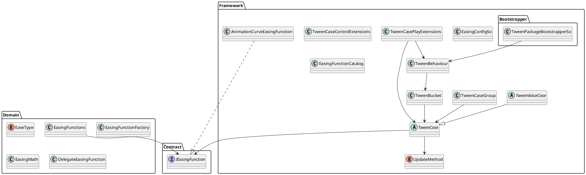

# README

## tween module



## Easing

## Concrete TweenCase in Framework

### Animation

### Audio

### Camera

### Graphic

### Image

### Material

### Particle

### RectTransform

```csharp
rectTransform
    .DOAnchoredPosition(new Vector2(100f, 0f), 0.3f)
    .SetEasing(EaseType.SineOut)
    .Play(tweenBehaviour);
```

```csharp
graphic
    .DOAnchoredPositionShake(10f, 0.25f)
    .Play(tweenBehaviour);
```

```csharp
rectTransform
    .DOSize(new Vector2(300f, 100f), 0.2f)
    .Play(tweenBehaviour);
```

### Renderer

```csharp
private static readonly int ColorId = Shader.PropertyToID("_BaseColor");
private static readonly int CutoffId = Shader.PropertyToID("_Cutoff");

renderer
    .DOPropertyBlockColor(ColorId, Color.red, 0.3f)
    .Play(tweenBehaviour);

renderer
    .DOPropertyBlockFloat(CutoffId, 1f, 0.3f)
    .Play(tweenBehaviour);
```

### SpriteRenderer

Graphic 때와 같아. 같은 SpriteRenderer에 DOColor와 DOFade를 동시에 걸면 둘 다 color 전체를 다시 세팅하기 때문에 서로 값을 덮어쓸 수 있음. 같은 target에는 color tween과 fade tween을 동시에 걸지 않는 쪽이 안전해.

### TweenCases

```plantuml
TweenCases
AsyncOperationTweenExtensions

DelayTweenCase
FloatTweenCase
ColorTweenCase
ActionTweenCase<T>
ConditionTweenCase
WaitUntilTweenCase
NextFrameTweenCase
AsyncOperationTweenCase
```

```csharp
TweenCases
    .DelayedCall(0.5f, () => Debug.Log("Done"))
    .Play(tweenBehaviour);
```

```csharp
TweenCases
    .DOFloat(0f, 1f, 0.25f, value => canvasGroup.alpha = value)
    .SetEasing(EaseType.SineOut)
    .Play(tweenBehaviour);
```

```csharp
TweenCases
    .NextFrame(() => Debug.Log("Next frame"))
    .Play(tweenBehaviour);
```

```csharp
operation
    .OnCompleted(() => Debug.Log("Load completed"))
    .Play(tweenBehaviour);
```

### Text

```plantuml
TextTweenExtensions

UnityTextFontSizeTweenCase
TextMeshFontSizeTweenCase
TextMeshFadeTweenCase
TextMeshColorTweenCase
TMPTextFontSizeTweenCase
```

```csharp
legacyText
    .DOFontSize(32, 0.25f)
    .SetEasing(EaseType.SineOut)
    .Play(tweenBehaviour);
```

```csharp
textMesh
    .DOFade(0f, 0.2f)
    .Play(tweenBehaviour);
```

```csharp
tmpText
    .DOFontSize(42f, 0.3f)
    .Play(tweenBehaviour);
```

### Transform

```plantuml
TransformTweenExtensions

TransformPositionTweenCase
TransformPositionAxisTweenCase
TransformLocalPositionTweenCase
TransformLocalPositionAxisTweenCase
TransformScaleTweenCase
TransformScaleAxisTweenCase
TransformRotationEulerTweenCase
TransformRotationQuaternionTweenCase
TransformLocalRotationEulerTweenCase
TransformLocalRotationQuaternionTweenCase
TransformConstantRotationTweenCase
TransformPathTweenCase
TransformBezierPositionTweenCase
TransformFollowTweenCase
TransformBezierFollowTweenCase
TransformPushScaleTweenCase
TransformPingPongScaleTweenCase
TransformLookAtTweenCase
TransformLookAt2DTweenCase
TransformShakeTweenCase
```

```csharp
transform
    .DOMove(new Vector3(0f, 2f, 0f), 0.3f)
    .SetEasing(EaseType.SineOut)
    .Play(tweenBehaviour);
```

```csharp
transform
    .DOScale(1.2f, 0.2f)
    .Play(tweenBehaviour);
```

```csharp
transform
    .DORotate(new Vector3(0f, 180f, 0f), 0.5f)
    .SetEasing(EaseType.SineInOut)
    .Play(tweenBehaviour);
```

```csharp
transform
    .DOShake(0.2f, 0.3f)
    .Play(tweenBehaviour);
```

### UI

```plantuml
UITweenExtensions
LayoutElementPreferredHeightTweenCase
CanvasGroupFadeTweenCase
```

## TweenPlayerBehaviour

- Inspector-driven tween player
- 매 loop마다 새 TweenCase 생성
- TweenBehaviour.Play 기반
- EaseType 사용
- Concrete player는 CreateTweenCase만 구현

---

## TODO

1. Tween 실행기를 Unity MonoBehaviour에서 분리하고 싶다
2. Tween을 awaitable Task로 다루고 싶다
3. 외부 모듈이 TweenBehaviour를 직접 몰랐으면 좋겠다
4. ITweenRunner만 주입받아서 tween을 실행하고 싶다
5. TweenCase를 외부에 노출하지 않고 ITweenHandle만 반환하고 싶다
6. 테스트 가능한 순수 playback loop가 필요하다

TweenBehaviour가 현재 runner
TweenCase가 현재 handle 역할
TweenBucket이 현재 playback loop 역할

---

ITweenRunner
  외부가 의존하는 실행 서비스

TweenRunner
  실제 실행 서비스

TweenPlaybackLane
  update method별 playback loop

TweenHandle
  외부 제어/await 대상

TweenBehaviour
  Unity Update를 TweenRunner에 전달하는 adapter

TweenCase
  실행 가능한 concrete playable

---

- Domain:
- 순수한 규칙
- 외부 실행 환경을 모르는 계산
- 시간이 흘러도 자기 혼자 의미가 있는 모델
- side effect가 거의 없는 값/정책

Domain
- EaseType
- IEasingFunction 구현체들
- EasingFunctions
- EasingFunctionFactory
- EasingMath
- TweenProgress 같은 순수 값 객체가 있다면 그것

App
- TweenRunner
- TweenPlaybackLane
- TweenHandle
- TweenCase

TweenHandle은 도메인 규칙이 아니라 실행 중인 tween을 외부에서 제어하기 위한 app handle

TweenPlaybackLane은 scheduler
- Update lane
- FixedUpdate lane
- LateUpdate lane
- active tween list 관리
- pending add 관리
- tick마다 deltaTime 전달
- 완료/kill된 tween 제거

TweenCase는
- 실행 상태 보유
- lifecycle 보유
- Completed / Killed event 발행
- TweenRunner가 Tick하면서 실행
- concrete Framework tween들이 상속해서 side effect 수행

그래서 TweenCase가 순수 도메인 모델이라기보다 TweenService가 실행할 수 있는 객체로 봐야함