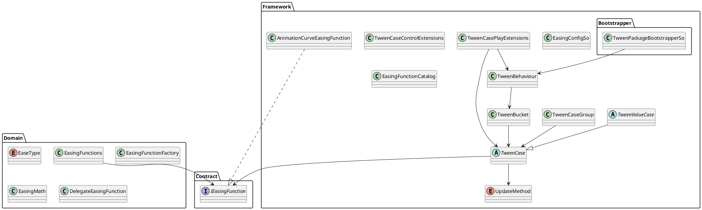

# README

For designer-facing TweenPlayer usage, see `Documentation~/TweenPlayerDesignerGuide.ko.md`.

## tween module



## Easing

## Concrete TweenCase in Framework

### Animation

### Audio

### Camera

### Graphic

### Image

### Material

### Particle

### RectTransform

```csharp
rectTransform
    .DOAnchoredPosition(new Vector2(100f, 0f), 0.3f)
    .SetEasing(EaseType.SineOut)
    .Play(tweenBehaviour);
```

```csharp
graphic
    .DOAnchoredPositionShake(10f, 0.25f)
    .Play(tweenBehaviour);
```

```csharp
rectTransform
    .DOSize(new Vector2(300f, 100f), 0.2f)
    .Play(tweenBehaviour);
```

### Renderer

```csharp
private static readonly int ColorId = Shader.PropertyToID("_BaseColor");
private static readonly int CutoffId = Shader.PropertyToID("_Cutoff");

renderer
    .DOPropertyBlockColor(ColorId, Color.red, 0.3f)
    .Play(tweenBehaviour);

renderer
    .DOPropertyBlockFloat(CutoffId, 1f, 0.3f)
    .Play(tweenBehaviour);
```

### SpriteRenderer

Graphic 때와 같아. 같은 SpriteRenderer에 DOColor와 DOFade를 동시에 걸면 둘 다 color 전체를 다시 세팅하기 때문에 서로 값을 덮어쓸 수 있음. 같은 target에는 color tween과 fade tween을 동시에 걸지 않는 쪽이 안전해.

### TweenCases

```plantuml
TweenCases
AsyncOperationTweenExtensions

DelayTweenCase
FloatTweenCase
ColorTweenCase
ActionTweenCase<T>
ConditionTweenCase
WaitUntilTweenCase
NextFrameTweenCase
AsyncOperationTweenCase
```

```csharp
TweenCases
    .DelayedCall(0.5f, () => Debug.Log("Done"))
    .Play(tweenBehaviour);
```

```csharp
TweenCases
    .DOFloat(0f, 1f, 0.25f, value => canvasGroup.alpha = value)
    .SetEasing(EaseType.SineOut)
    .Play(tweenBehaviour);
```

```csharp
TweenCases
    .NextFrame(() => Debug.Log("Next frame"))
    .Play(tweenBehaviour);
```

```csharp
operation
    .OnCompleted(() => Debug.Log("Load completed"))
    .Play(tweenBehaviour);
```

### Text

```plantuml
TextTweenExtensions

UnityTextFontSizeTweenCase
TextMeshFontSizeTweenCase
TextMeshFadeTweenCase
TextMeshColorTweenCase
TMPTextFontSizeTweenCase
```

```csharp
legacyText
    .DOFontSize(32, 0.25f)
    .SetEasing(EaseType.SineOut)
    .Play(tweenBehaviour);
```

```csharp
textMesh
    .DOFade(0f, 0.2f)
    .Play(tweenBehaviour);
```

```csharp
tmpText
    .DOFontSize(42f, 0.3f)
    .Play(tweenBehaviour);
```

### Transform

```plantuml
TransformTweenExtensions

TransformPositionTweenCase
TransformPositionAxisTweenCase
TransformLocalPositionTweenCase
TransformLocalPositionAxisTweenCase
TransformScaleTweenCase
TransformScaleAxisTweenCase
TransformRotationEulerTweenCase
TransformRotationQuaternionTweenCase
TransformLocalRotationEulerTweenCase
TransformLocalRotationQuaternionTweenCase
TransformConstantRotationTweenCase
TransformPathTweenCase
TransformBezierPositionTweenCase
TransformFollowTweenCase
TransformBezierFollowTweenCase
TransformPushScaleTweenCase
TransformPingPongScaleTweenCase
TransformLookAtTweenCase
TransformLookAt2DTweenCase
TransformShakeTweenCase
```

```csharp
transform
    .DOMove(new Vector3(0f, 2f, 0f), 0.3f)
    .SetEasing(EaseType.SineOut)
    .Play(tweenBehaviour);
```

```csharp
transform
    .DOScale(1.2f, 0.2f)
    .Play(tweenBehaviour);
```

```csharp
transform
    .DORotate(new Vector3(0f, 180f, 0f), 0.5f)
    .SetEasing(EaseType.SineInOut)
    .Play(tweenBehaviour);
```

```csharp
transform
    .DOShake(0.2f, 0.3f)
    .Play(tweenBehaviour);
```

### UI

```plantuml
UITweenExtensions
LayoutElementPreferredHeightTweenCase
CanvasGroupFadeTweenCase
```
